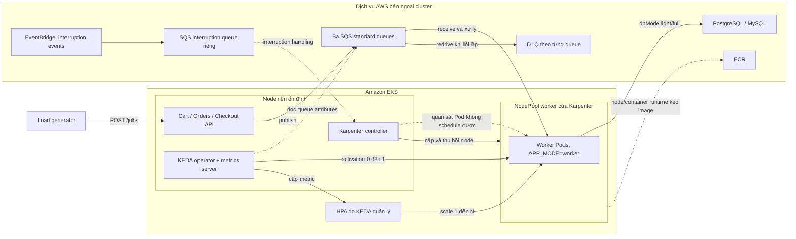

# Kế hoạch V2: Backend cho lab EKS, SQS, KEDA và Karpenter

> Phiên bản: 2.1 — cập nhật 2026-10-27  
> Trạng thái: kế hoạch triển khai và kiểm chứng; chưa xác nhận stack trên EKS.  
> Mục tiêu: chạy benchmark event-driven có thể tái lập, quan sát và đo được chuỗi SQS → KEDA/HPA → worker → Karpenter trên Amazon EKS.

## 1. Phạm vi và nguyên tắc

- Ưu tiên lab hạ tầng/autoscaling với workload benchmark, theo lựa chọn đã xác nhận. Cart, Orders và Checkout có API producer, worker consumer và endpoint `POST /jobs`; các job là workload mô phỏng.
- Giữ Catalog, Recommendations, UI và load generator. UI chỉ bật khi demo; load generator cần có kịch bản gọi trực tiếp backend.
- Mỗi service Cart/Orders/Checkout dùng một image cho hai mode `APP_MODE=api` và `APP_MODE=worker`, triển khai thành hai workload riêng. API tiếp nhận request; worker lấy job từ queue của chính service đó.
- Giữ định hướng v1: Compose backend tại root và UI overlay riêng. LocalStack phục vụ kiểm thử local; kết quả local không chứng minh IAM, KEDA, Karpenter hay hành vi SQS thật trên AWS.
- Luồng nghiệp vụ Checkout → Orders hoàn chỉnh là hạng mục tương lai độc lập, không phải điều kiện để hoàn thành benchmark hạ tầng V2. Hiện submit Checkout chưa chứng minh đã tạo đơn trong Orders; không dùng luồng đó để tuyên bố benchmark business end-to-end.
- Mục tiêu thời gian, cỡ image và chi phí là kết quả cần đo. Không mặc định node luôn sẵn sàng trong 30–45 giây, mọi image dưới 50 MB hay tổng chi phí về 0 khi worker scale về 0.
- Tài liệu này kế thừa các quyết định giữ service trong [v1](v1.md), và điều chỉnh thứ tự các phase còn lại theo mục tiêu EKS. Không coi việc có manifest hoặc lint thành công là đã triển khai thành công.

**Ranh giới hạ tầng:** Chưa có thông tin xác nhận EKS, VPC, IAM, registry hoặc database do repo nào quản lý. Phase 0 phải chốt đầu mối: dùng hạ tầng có sẵn hay bổ sung IaC riêng. Không khôi phục nguyên trạng Terraform upstream đã bị xóa chỉ để đáp ứng checklist.

## 2. Kiến trúc mục tiêu

SQS là dịch vụ AWS bên ngoài EKS. KEDA đọc trạng thái queue và điều khiển scaling; worker mới là thành phần nhận/xóa message. Karpenter phản ứng với pod không schedule được trong giới hạn NodePool, không trực tiếp xử lý job hay kéo image.

**KEDA:** Ở scale-to-zero, KEDA xử lý activation; từ 1 đến N, HPA điều chỉnh dựa trên metric của scaler. Với scaler SQS, mặc định tính cả message visible và in-flight khi `scaleOnInFlight=true`. `queueLength` là target theo replica, không có nghĩa cứ 10 message sẽ tạo 10 pod. Các giá trị gần đúng và quyết định thực tế còn phụ thuộc polling, HPA và giới hạn replica. [KEDA SQS scaler](https://keda.sh/docs/2.21/scalers/aws-sqs/); [KEDA scaling](https://keda.sh/docs/2.21/concepts/scaling-deployments/).

**Karpenter:** NodePool/EC2NodeClass, tài nguyên yêu cầu, taint/toleration, architecture, subnet và capacity phải phù hợp; thử nghiệm cần tạo được pod thực sự không thể schedule lên node hiện hữu. Đo node provisioning, đăng ký node, image pull và worker ready thành các khoảng riêng. [Karpenter scheduling](https://karpenter.sh/docs/concepts/scheduling/) và [NodePools](https://karpenter.sh/docs/concepts/nodepools/).

## 3. Đường cơ sở đã rà soát

Các nhận định sau dựa trên source và cấu hình ở lượt rà soát ngày 2026-10-27; không có kết quả chạy SQS thật hoặc EKS trong lượt này.

| Thành phần | Hiện có | Còn thiếu hoặc cần xác nhận |
|---|---|---|
| Local Compose | [Compose root](../docker-compose.yml) gồm 5 backend, một PostgreSQL và một MySQL; [UI overlay](../docker-compose.ui.yml) đã có. Hai file qua `docker compose config`. | Chưa xác nhận toàn bộ build/start từ trạng thái sạch; LocalStack/worker chưa có cấu hình tích hợp hoàn chỉnh. Chuyển `APP_MODE=worker` trong service hiện tại sẽ thay API bằng worker, không tạo hai container đồng thời. |
| Backend | Ba service có `/jobs`, SQS worker, mode API/worker và metrics. | Cần sửa các lỗi P0 ở mục 4 trước benchmark; hành vi giữa ba worker chưa đồng nhất. |
| UI | Wrapper LF và Dockerfile đã được sửa; image UI đã build thành công ở lượt trước. | UI là tùy chọn; kết quả build UI không xác nhận build hay runtime của toàn bộ backend. |
| Helm | Chart từng service, Deployment API/worker và SQS ScaledObject đã có; năm chart backend qua `helm lint`. | Chưa xác nhận deploy trên EKS; values mặc định còn phụ thuộc môi trường upstream/AWS cụ thể, authentication chưa được chuẩn hóa cho lab. |
| Tổng hợp chart | [Umbrella chart](../src/app/chart/Chart.yaml) và [Helmfile](../src/app/helmfile.yaml) đã có. | Cả hai chưa tích hợp Recommendations; [values-stateful](../src/app/chart/values-stateful.yaml) vẫn chứa DynamoDB, Redis và RabbitMQ cũ. |
| Artillery | [Scenario](../src/load-generator/scenario.yml) hiện chạy qua UI. | Chưa có kịch bản benchmark `/jobs` trực tiếp, đối soát message hoặc báo cáo thí nghiệm. |
| Hạ tầng AWS | Chart có tên nodegroup, NodePool selector và ví dụ SQS. | Repo hiện không có IaC EKS/Karpenter/SQS đã được xác nhận vận hành; không giả định cluster hoặc quyền AWS đã sẵn sàng. |

## 4. Các vấn đề ưu tiên

### P0 — Chặn tính đúng đắn của benchmark

1. **Orders worker có nguy cơ kẹt sau batch đầu.** [processBatch](../src/orders/pkg/worker/worker.go) chờ `wg.Wait()` trước khi đóng channel, còn các goroutine có thể đang chờ channel. Đây là kết luận từ đọc code; cần viết test tái hiện và sửa để xử lý nhiều batch liên tiếp, kể cả khi không có tín hiệu shutdown.
2. **Orders ép credentials test trên AWS.** [initSQSClient](../src/orders/main.go) chọn static credentials `test/test` khi không thấy access key, làm lệch credential chain trên EKS. Cần chỉ dùng credentials giả khi cấu hình LocalStack rõ ràng; AWS dùng SDK default chain. Cart cũng cần rà soát fallback theo endpoint để tránh vô tình áp dụng credentials giả với endpoint AWS tùy chỉnh. [AWS SDK credential chain](https://docs.aws.amazon.com/eks/latest/userguide/pod-id-minimum-sdk.html).
3. **Publish có thể báo thành công sai.** Ba producer cần kiểm tra từng kết quả của `SendMessageBatch`; [Orders](../src/orders/pkg/api/api.go) và [Cart](../src/cart/main.go) hiện bỏ qua response batch, [Checkout](../src/checkout/app/worker.py) cũng đếm toàn bộ messages mà không xét `Failed`. Checkout `/jobs` còn bỏ qua giá trị trả về của publish khi thiếu queue/client. Chỉ báo và tăng counter cho message được SQS xác nhận; định nghĩa response cho partial failure. [AWS SendMessageBatch](https://docs.aws.amazon.com/AWSSimpleQueueService/latest/APIReference/API_SendMessageBatch.html).
4. **Worker lifecycle chưa đảm bảo cho scale-down.** Checkout liên tục submit vào executor và shutdown executor trước khi chờ polling thread; cần giới hạn prefetch/in-flight, dừng nhận job mới, xử lý job đang chạy và trả các message chưa bắt đầu về queue. Orders `Stop()` hiện chỉ đóng channel tín hiệu; main cần chờ worker xử lý/cleanup trước khi đóng repository. Rà soát tương đương ở Cart. Kiểm thử SIGTERM trong lúc polling, xử lý batch và xóa message.
5. **Cần contract retry và idempotency.** Chọn SQS standard cho baseline; cấu hình visibility timeout, redrive policy và một DLQ cho từng queue; chỉ xóa message sau xử lý thành công hoặc xác nhận duplicate an toàn. Message lỗi định dạng phải có chính sách rõ ràng để không bị ACK như job hợp lệ. SQS standard có thể giao lại message; không khẳng định exactly-once. [AWS at-least-once](https://docs.aws.amazon.com/AWSSimpleQueueService/latest/SQSDeveloperGuide/standard-queues-at-least-once-delivery.html); [visibility timeout](https://docs.aws.amazon.com/AWSSimpleQueueService/latest/SQSDeveloperGuide/sqs-visibility-timeout.html).

### P1 — Chặn triển khai và phép đo đáng tin cậy

6. **KEDA auth và cấu hình chart.** Ba ScaledObject chưa có `authenticationRef` tường minh. Thiết kế role đọc queue attributes cho KEDA riêng với role producer/worker; dùng provider và cơ chế auth phù hợp với KEDA thực tế đã pin. Metadata `identityOwner: operator` trong bản V2 cũ là cơ chế deprecated; không nhầm provider `aws-eks` của KEDA với tên dịch vụ EKS Pod Identity. [KEDA AWS authentication](https://keda.sh/docs/2.21/authentication-providers/aws/) và [SQS scaler](https://keda.sh/docs/2.21/scalers/aws-sqs/).
7. **Chart có sai lệch làm hỏng thử nghiệm.** `helm template` với `worker.scaledObject.scaleOnInFlight=false` đã render `"true"` do dùng `default` với boolean false; cần sửa và test true/false trên cả ba chart. Chart Checkout xuất `AWS_REGION` nhưng [config Python](../src/checkout/app/config.py) đọc `AWS_DEFAULT_REGION`. Chart cũng đưa `DB_SSLMODE` nhưng cần xác minh đường đi đến driver Checkout trước khi tuyên bố TLS đã được áp dụng.
8. **Health và database có thể tạo tín hiệu sai.** Orders và Checkout `/health` chủ yếu phản ánh chaos toggle; chưa chứng minh worker có queue/credentials hợp lệ hoặc đang polling. Checkout còn fallback in-memory khi cấu hình PostgreSQL thất bại. Tách liveness, readiness và dependency checks theo vai trò; với thí nghiệm cần DB, phải phát hiện DB lỗi thay vì ghi nhận kết quả in-memory như PostgreSQL.
9. **Benchmark chưa có hợp đồng và phép đo.** `workUnits` hiện dùng vòng lặp theo thời gian trôi qua; CPU quota, scheduler và Python GIL có thể làm lượng CPU thực khác nhau. Không so sánh các runtime theo cùng con số mà chưa hiệu chuẩn. Ba worker cũng có cách concurrency/prefetch và nội dung log khác nhau; metric cold-start Checkout được khởi tạo ở cả lifecycle API và worker.
10. **Thiếu hợp đồng platform.** Cần image registry/tag, cluster và controller versions, IAM, database endpoint, queue/DLQ, mạng và quota. Không mặc định `pgbouncer:6432`, nodegroup upstream, SQS URL rỗng, hoặc chart mặc định trỏ upstream ECR là hợp lệ với cluster thật.

## 5. Hợp đồng cấu hình giữa backend và hạ tầng

Hạ tầng dự kiến có **RDS PostgreSQL và RDS MySQL**. Môi trường cung cấp địa chỉ, tên tài nguyên và quyền cụ thể; không đưa giá trị thật hoặc mật khẩu vào Git. Không giả định có PgBouncer, RDS Proxy, cluster hoặc IAM role nếu chưa được cung cấp.

| Thành phần | Đầu vào backend/Helm cần nhận | Công việc cần hoàn thành |
|---|---|---|
| Cart, Orders, Checkout | RDS PostgreSQL hostname, port, database, user/password hoặc cơ chế xác thực được chọn, TLS/CA và pool; schema tương ứng `cart`, `orders`, `checkout`. | Chart mặc định `pgbouncer:6432`, không phải endpoint RDS. Chốt kết nối trực tiếp hoặc qua proxy có sẵn; ba schema đang được code tham chiếu cố định, chưa thể đổi chỉ bằng `DB_SCHEMA`. Kiểm tra quyền khởi tạo schema/bảng, migration và pool khi scale. |
| Catalog, Recommendations | RDS MySQL hostname:port, tên database, user/password, TLS/CA và pool. | Cấu hình `app.persistence` của từng chart; hai service hiện mặc định dùng `catalogdb`, cần xác nhận dữ liệu catalog và quyền đọc phù hợp. Kiểm tra driver hỗ trợ TLS và xác minh chứng chỉ. |
| Cart, Orders, Checkout | Một SQS standard queue URL cho mỗi service và AWS region. API, worker và ScaledObject của cùng service phải trỏ đúng cùng queue. | Tạo thêm một DLQ cho từng queue và redrive policy trên AWS. Queue interruption của Karpenter là tài nguyên riêng, không tính vào ba queue ứng dụng. Chỉ dùng `AWS_ENDPOINT_URL` khi chủ động chọn LocalStack hoặc endpoint tương thích; không để endpoint local trong cấu hình EKS. |
| Danh tính AWS | IAM role, ServiceAccount và trust/association theo IRSA hoặc EKS Pod Identity đã chọn. | Cấp quyền gửi cho API, nhận/xóa/đổi visibility cho worker, đọc queue attributes cho KEDA; kiểm tra quyền KMS nếu queue dùng customer-managed key. Không lưu access key tĩnh trong image hoặc values. |
| KEDA và Karpenter | Queue URL/region, TriggerAuthentication, ngưỡng scale, NodePool labels/taints, CPU/memory requests và giới hạn replica. | Pin phiên bản controller; sửa chart render đúng boolean, đảm bảo scheduling khớp NodePool và không vượt sức chịu của RDS. KEDA/HPA điều chỉnh số worker; Karpenter cấp node khi pod chưa schedule được. |
| Triển khai và vận hành | ECR image repository và digest/tag, namespace, secret references, cấu hình service discovery, metrics và health endpoints. | Backend/Helm tham chiếu image và secret của môi trường, expose service cần thiết, cung cấp metrics/readiness có ý nghĩa; quyết định UI/Ingress nếu cần truy cập từ ngoài. |

**Phân chia trách nhiệm:** hạ tầng cấp RDS, queue/DLQ, IAM, kết nối mạng, controller và registry; backend cung cấp code kết nối, cấu hình/Helm, lifecycle, migration và telemetry. Ownership có thể khác tùy repo IaC, nhưng phải ghi rõ ai tạo và cung cấp từng đầu vào.

- [ ] Tạo bảng cấu hình cho từng môi trường: endpoint, port, database, schema, secret reference, queue URL/ARN, region, role, NodePool và image; phân biệt thông số bắt buộc với tùy chọn.
- [ ] Trên RDS, cho phép kết nối từ security group phù hợp của workload, kiểm tra DNS/routing/NACL và database credentials từ pod; chốt TLS có kiểm tra CA/hostname theo từng driver, gồm phân phối và xoay CA. [AWS RDS security groups](https://docs.aws.amazon.com/AmazonRDS/latest/gettingstartedguide/security-groups.html); [RDS TLS](https://docs.aws.amazon.com/AmazonRDS/latest/UserGuide/UsingWithRDS.SSL.html).
- [ ] Chuẩn hóa migration/seed và quyền DB: Cart/Orders/Checkout hiện tạo schema khi khởi động, Catalog chạy migration khi khởi tạo; làm rõ ai chạy, xử lý khởi động đồng thời, và quyền runtime tối thiểu sau migration.
- [ ] Giới hạn connection pool theo service và max replicas; tính tổng kết nối API + worker + các service khác, tính cả khả năng scale đồng thời, đối chiếu capacity RDS. Đo DB connections/latency khi chạy benchmark.
- [ ] Rà soát TLS thực tế: Cart/Orders có `DB_SSLMODE` nhưng mặc định `disable`; Checkout chưa xác nhận truyền SSL mode tới driver; Catalog/Recommendations cần xác minh và bổ sung TLS/CA nếu thiếu. Không coi một giá trị chart là bằng chứng kết nối đã được mã hóa hoặc xác minh hostname.
- [ ] Sửa mismatch region Checkout (`AWS_REGION` trong chart, `AWS_DEFAULT_REGION` trong code), cơ chế secret có sẵn, credential chain Orders và các lỗi worker/publish ở mục 4 trước khi dùng AWS thật.

## 6. Thứ tự thực hiện

### Phase 0 — Chốt phạm vi, thông số và ownership

- [ ] Xác định cluster EKS có sẵn hay cần IaC; xác định repo/chủ sở hữu EKS, VPC, KEDA, Karpenter, ECR, SQS, database và observability.
- [ ] Ghi account, region, namespace, kiến trúc CPU, EKS/Kubernetes, KEDA, Karpenter, Helm và AMI đã được kiểm tra tương thích; pin phiên bản khi triển khai. Tài liệu KEDA liên kết trong plan dùng 2.21 để tham khảo, không ngầm khẳng định đây là phiên bản đang cài.
- [ ] Chốt ngân sách thử nghiệm, NodePool resource limits, giới hạn replicas, thời lượng, điều kiện dừng và người chịu trách nhiệm cleanup. Giữ node nền cho controller và tải thử.
- [ ] Chọn identity cho workload và KEDA. Phương án đề xuất cho lab đầu tiên: IRSA với KEDA dùng role của operator; nếu hạ tầng đã dùng EKS Pod Identity, xác minh tương thích theo phiên bản trước khi chọn. Không lưu static AWS keys trong Helm values của EKS.
- [ ] Chốt SQS standard, một queue + DLQ cho mỗi service; queue interruption của Karpenter là tài nguyên riêng. Chọn retention, visibility, `maxReceiveCount` và encryption theo môi trường, ghi rõ assumptions.
- [ ] Chốt `dbMode` và địa điểm PostgreSQL/MySQL cho từng phép đo. Với `none`, đo CPU/SQS riêng; với `light/full`, ghi rõ DB, pool, migrations và network để giải thích tác động.

**Đầu ra:** một bảng tham số lab và ownership có thể triển khai; không ghi secret thật trong repo.

### Phase 1 — Sửa producer/worker và test ở cấp service

- [ ] Sửa deadlock Orders; test xử lý ít nhất ba batch liên tiếp, batch rỗng và context cancellation; test shutdown khi có message chưa bắt đầu và đang xử lý.
- [ ] Sửa credential chain ở Orders, kiểm tra Cart/Checkout với cấu hình LocalStack và AWS; test không có access key tĩnh và test endpoint giả chỉ được kích hoạt theo cấu hình local rõ ràng.
- [ ] Chuẩn hóa `POST /jobs`: validation, giới hạn batch, ý nghĩa `workUnits` và `dbMode`; không thay request JSON lỗi thành job mặc định. Cập nhật OpenAPI/README nếu thay contract.
- [ ] Kiểm tra partial batch failure, retry có giới hạn và response/counter chính xác cho từng message. Test queue thiếu, lỗi IAM/transport và một phần batch bị từ chối.
- [ ] Giới hạn số job đã nhận nhưng chưa bắt đầu; thống nhất ý nghĩa `SQS_MAX_MESSAGES` và `WORKER_CONCURRENCY`. Không cần làm ba implementation giống nhau, nhưng phải đo được concurrency và sức chứa thực.
- [ ] Triển khai shutdown có thứ tự: dừng polling → hoàn tất hoặc giải phóng job chưa bắt đầu → ACK kết quả hợp lệ → đóng DB/client trong grace period. Đối chiếu visibility timeout với thời gian xử lý, thời gian nằm trong buffer và shutdown; hỗ trợ gia hạn visibility nếu workload vượt timeout.
- [ ] Chốt idempotency theo `jobId` và DB mode: `light/full` cần kiểm chứng bằng dữ liệu bền vững; `none` không có DB ledger nên không tự chứng minh xử lý đúng một lần. Đếm retry/duplicate riêng; giữ message lỗi cho redrive/DLQ theo policy.
- [ ] Sửa health/readiness và cấu hình region; worker thiếu queue/config hoặc không thể hoạt động phải được phát hiện theo policy đã chốt. Không để API/worker báo healthy nhưng dữ liệu bị fallback ngoài ý muốn.
- [ ] Xử lý logging lỗi DB để không in connection URL chứa mật khẩu; kiểm tra migrations khi nhiều replica khởi động đồng thời.

**Đạt khi:** unit/integration tests tái hiện các lỗi P0 trước sửa và pass sau sửa; các test bao gồm xử lý nhiều batch, partial publish, duplicate, malformed message, DB/SQS failure và shutdown. Ghi lệnh, môi trường và kết quả; không dùng `helm lint` thay cho test runtime.

### Phase 2 — Kiểm thử local end-to-end cho workload benchmark

- [ ] Rà soát hai file Compose root đã có thay vì tạo lại; xác nhận `docker compose config` và build/start từ trạng thái sạch, kiểm tra DB readiness, migration/seed và UI overlay khi bật.
- [ ] Tạo overlay/profile worker và LocalStack: chạy **API và worker đồng thời** từ cùng image, mỗi service có queue/DLQ riêng và dùng hostname LocalStack truy cập được từ container.
- [ ] Tự động tạo queue/DLQ và cấu hình redrive; lưu các biến cần thiết vào template môi trường local, không thay thế queue AWS thật.
- [ ] Chạy chuỗi `POST /jobs → SQS → worker → kết quả` cho Cart, Orders, Checkout. Kiểm tra `none/light/full` theo khả năng từng service và xác nhận số lượng publish/processed/duplicate/failure.
- [ ] Test SQS unavailable, DB unavailable, duplicate, message không hợp lệ và SIGTERM; đối chiếu retry/DLQ và kết quả lưu bền vững khi có DB.

**Đạt khi:** cả ba service xử lý nhiều batch liên tục và đối soát được các job đã được chấp nhận. LocalStack chỉ là cổng kiểm thử trước EKS; vẫn cần kiểm tra IAM, scale và SQS thật trên AWS.

### Phase 3 — Image và pipeline

- [ ] Build năm image backend, chạy container smoke test, health và kiểm thử cấu hình API/worker. Giữ UI image tùy chọn; không lấy kết quả build UI làm bằng chứng cho backend.
- [ ] Đồng bộ phiên bản build Go với `go.mod`; Orders hiện dùng base `golang:1.23-alpine` trong khi module yêu cầu Go 1.26 và đang bật auto-toolchain. Pin toolchain và image base để build có thể tái lập.
- [ ] Đo kích thước image hiện tại, thời gian pull theo kiến trúc node, cache warm/cold và thời gian start trước khi đặt mục tiêu tối ưu. Catalog/Cart còn Amazon Linux; Orders đã dùng Alpine; Python đã dùng `python:3.12-slim`. Tối ưu tiếp theo kết quả đo và kiểm thử binary/dependencies/probes.
- [ ] Tạo pipeline lint/test từng service → build → scan → push ECR với tag theo commit và digest; cung cấp cấu hình Helm trỏ image đã build. Build kiến trúc khớp NodePool; multi-arch chỉ khi cần và được kiểm chứng.
- [ ] Kiểm tra pipeline không nhúng secret hoặc cấu hình LocalStack vào image EKS; ghi image digest vào kết quả benchmark.

**Đạt khi:** các image backend build được, chạy smoke test, push/pull được từ registry đã chọn và cùng digest được dùng trong deployment thử nghiệm.

### Phase 4 — Hạ tầng EKS, IAM, SQS và Karpenter

- [ ] Theo ownership Phase 0, cung cấp IaC hoặc hợp đồng đầu vào có thể kiểm chứng cho EKS/VPC, ECR, PostgreSQL/MySQL, SQS/DLQ, KEDA và Karpenter. Có hướng dẫn tạo, cập nhật và cleanup; không commit state/credentials.
- [ ] Cấp quyền theo vai trò: producer `sqs:SendMessage` cho queue của service; worker `ReceiveMessage`, `DeleteMessage` và `ChangeMessageVisibility` theo nhu cầu; KEDA `GetQueueAttributes` cho các queue cần scale. Bổ sung quyền khác chỉ khi code/cấu hình thực sự yêu cầu. [Bảng quyền SQS](https://docs.aws.amazon.com/AWSSimpleQueueService/latest/SQSDeveloperGuide/sqs-api-permissions-reference.html).
- [ ] Tách ServiceAccount/API và worker khi cần IAM khác nhau; cấu hình KEDA operator role, workload role, trust policy và namespace theo phương án đã chốt. Xác nhận principal thực tế có đúng role; kiểm thử từ chối quyền ngoài phạm vi.
- [ ] Nếu cluster private: xác nhận DNS, routes, security groups và egress hoặc endpoints cần thiết cho SQS, ECR, STS/identity, EC2, logs và DB; kiểm thử từ pod. [EKS private cluster](https://docs.aws.amazon.com/eks/latest/userguide/private-clusters.html).
- [ ] Duy trì capacity nền cho KEDA, Karpenter, DNS và thành phần quan sát. Tạo NodePool/EC2NodeClass cho worker, selector/taint/toleration tương ứng, requirements theo kiến trúc và capacity type, requests/limits có cơ sở đo.
- [ ] Có baseline On-Demand; thêm Spot sau khi baseline ổn định. Cấu hình interruption queue, EventBridge rules/targets và controller setting **riêng với queue ứng dụng**. Kiểm thử disruption, shutdown, redelivery và idempotency. [Karpenter interruption](https://karpenter.sh/docs/concepts/disruption/#interruption).
- [ ] Cấu hình consolidation/disruption budgets, node và pod termination grace period phù hợp workload. PDB không tự đảm bảo job hoàn tất trước mọi loại interruption; cần test thực tế.

**Đạt khi:** controllers ở node nền hoạt động, worker có thể nhận đúng IAM role; queue, DB và registry truy cập được; một pod worker cố ý unschedulable tạo NodeClaim/node hợp lệ và sau đó chạy được. Ghi versions và cấu hình đã sử dụng.

### Phase 5 — Chuẩn hóa Helm và KEDA

- [ ] Giữ hai Deployment API/worker đã có; tách ServiceAccount khi cần; API có Service, worker có endpoint metrics và readiness phù hợp. Chỉ bật worker/scaler khi giá trị đầu vào đầy đủ.
- [ ] Loại values stateful cũ, cấu hình database và image theo môi trường; bổ sung Recommendations vào umbrella chart/Helmfile nếu dùng cách triển khai tổng hợp. Cho phép tham chiếu Secret có sẵn ngay cả khi chart không tạo Secret.
- [ ] Bổ sung `TriggerAuthentication` + `authenticationRef` theo phiên bản KEDA đã pin; operator và workload phải có IAM phù hợp. Kiểm tra `queueURL`, region, namespace và role trước khi bật scale-to-zero.
- [ ] Sửa giá trị boolean `scaleOnInFlight=false` và các default làm mất số 0; test render cả true/false, kiểm tra selectors, ServiceMonitor, PDB và Deployment labels.
- [ ] Chốt `minReplicaCount`, `maxReplicaCount`, `queueLength`, `activationQueueLength`, `pollingInterval`, `cooldownPeriod` và HPA behavior từ baseline đo được. Khi KEDA quản lý scale, tránh cấu hình deployment hoặc công cụ reconcile liên tục ghi đè `spec.replicas`.
- [ ] Chọn nodeSelector/toleration khớp NodePool thật; toleration chỉ cho phép pod chịu taint, còn lựa chọn Spot phải được thể hiện trong NodePool/pod requirements.
- [ ] Cấu hình API replicas/health, worker resource requests và graceful termination; ServiceMonitor/KEDA CRD chỉ bật khi operator tương ứng đã được cài.

**Đạt khi:** `helm lint` và `helm template` cho cấu hình API-only và worker/KEDA đều pass; server-side validation trên cluster tương thích pass; deploy thử một service thành công, sau đó mở rộng sang ba service. Test thực tế scaler và IAM, không suy ra từ render.

### Phase 6 — Đo đạc và kịch bản benchmark

- [ ] Chuẩn hóa envelope tối thiểu: `schemaVersion`, `runId`, `jobId`, `enqueuedAt`, `workUnits`, `dbMode`; mô tả producer/consumer, validation và tính tương thích. Cho phép đối soát job ID giữa producer và worker; không dùng `jobId` làm Prometheus label.
- [ ] Định nghĩa mốc đo: client gửi request, SQS chấp nhận, scaler activation, pod tạo/pending, NodeClaim/node ready, container ready, worker bắt đầu job đầu, hoàn tất và ACK. Ghi rõ nguồn timestamp, clock synchronization, độ chính xác, giới hạn của SQS attributes gần đúng.
- [ ] Thu metrics queue visible/in-flight/delayed, DLQ, tuổi message; KEDA/HPA desired/current replicas và lỗi scaler; node/NodeClaim, pod pending, image pull/start, resource requests/usage, CPU throttling, memory và DB connections.
- [ ] Chuẩn hóa metrics/logs `published`, `processed`, `error`, `duplicate`, `in-flight`, latency theo service/queue và vai trò API/worker; mở rộng histogram buckets theo thời gian cold-start dự kiến. Đối soát bằng job ID/log hoặc ledger, không dùng queue depth gần đúng để chứng minh không mất message.
- [ ] Thêm Artillery hoặc công cụ phù hợp gọi `POST /jobs` trực tiếp. Ghi riêng request rate, `batchSize`, message rate, số job được SQS xác nhận, `workUnits`, `dbMode`, concurrency, tài nguyên/pod và duration; chạy warm-up rồi mới spike.
- [ ] Bắt đầu baseline đơn giản: một queue/service, `batchSize=1`, `SQS_MAX_MESSAGES=1`, `WORKER_CONCURRENCY=1` và `dbMode=none`; cố định CPU/memory requests/limits và architecture. Hiệu chuẩn CPU thực và thời gian xử lý trước khi so sánh Go/Python hoặc tăng concurrency.
- [ ] Đo nhiều lần, ghi median/P95/P99, sai số và các run lỗi; phân biệt cold pod trên node sẵn có với cold node phải provision, image cache warm/cold và `dbMode`. Thiết lập ngưỡng mục tiêu sau baseline, không giả định thời gian node hay kích thước image.
- [ ] Chạy các case: scale 0→1→N, queue drain và scale về 0; workload vượt capacity nền để quan sát Karpenter; DB/SQS failure; duplicate/DLQ; SIGTERM khi xử lý; Spot interruption và consolidation. Chỉ kết luận scale-to-zero của worker/worker nodes khi đã quan sát đủ điều kiện; chi phí nền của cluster và dịch vụ liên quan vẫn tồn tại.
- [ ] Lưu báo cáo cùng commit, image digest, cấu hình Helm, phiên bản, queue settings, instance type, thời gian, dữ liệu đo và chi phí ước tính từ nguồn phù hợp. Có điều kiện dừng tải và quy trình cleanup an toàn.

**Đạt khi:** mỗi run có cấu hình tái lập, đối soát được message đã chấp nhận với kết quả xử lý/DLQ, và báo cáo được thời gian từng giai đoạn cùng các ngoại lệ. Mọi con số hiệu năng là kết quả đo của môi trường, không là cam kết chung.

## 7. Tiêu chí hoàn thành V2

- [ ] P0 ở mục 4 được sửa và có test phù hợp; worker xử lý nhiều batch, dùng IAM role và shutdown có kiểm soát.
- [ ] Local API + SQS + worker chạy được cho ba service, có test retry/idempotency/DLQ và dữ liệu đối soát.
- [ ] Năm backend image build/smoke test và có đường đưa image vào EKS.
- [ ] Chart render đúng cấu hình, deploy được lên EKS với credentials, DB, queues và NodePool của môi trường; KEDA/Karpenter/controller CRDs và versions đã xác nhận.
- [ ] Quan sát được KEDA activation, HPA scaling, pod unschedulable → Karpenter provision, worker xử lý, scale-down và node consolidation trong tối thiểu một run có ghi nhận.
- [ ] Có runbook và báo cáo benchmark/tái lập, gồm baseline, giả định, limitations, failure cases và cleanup.
- [ ] README, hướng dẫn cấu hình và trạng thái các phase được cập nhật theo kết quả thực tế.

## 8. Ghi chú kế thừa và quyết định còn mở

- Phase 1–2 trong v1 đã được ghi nhận hoàn thành; Compose root và UI overlay đã xuất hiện trong working tree. Phase 3 chỉ hoàn tất sau kiểm tra runtime và worker/LocalStack theo phạm vi đã chốt.
- Tối ưu image, production hardening và triển khai business workflow đầy đủ có thể thực hiện sau khi baseline hạ tầng đáng tin cậy; không coi cỡ image cụ thể là điều kiện duy nhất để chạy Kubernetes.
- Cần chốt trước khi triển khai: nguồn sở hữu cluster/IaC, IAM mechanism cụ thể, region/account, EKS/KEDA/Karpenter versions, registry, database, namespace, architecture, giới hạn chi phí và mức độ dùng Spot.
- Không có deployment, thay đổi AWS hay test EKS nào được thực hiện trong lúc soạn tài liệu này.

